

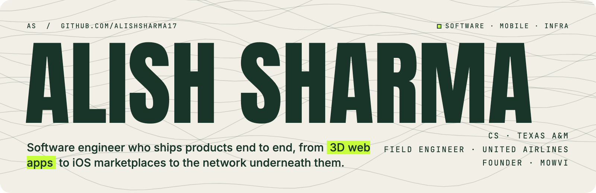

  

   

 

I study computer science at **Texas A&M**, keep airline systems running as a **Field Engineer at United Airlines**, and I'm building **Mowvi**, an on-demand lawn care marketplace for iOS.

I like products that work all the way down: the interface, the data model, and the network it runs on. Below are things I've designed, built, tested and shipped myself.

 

## ◼ Building now

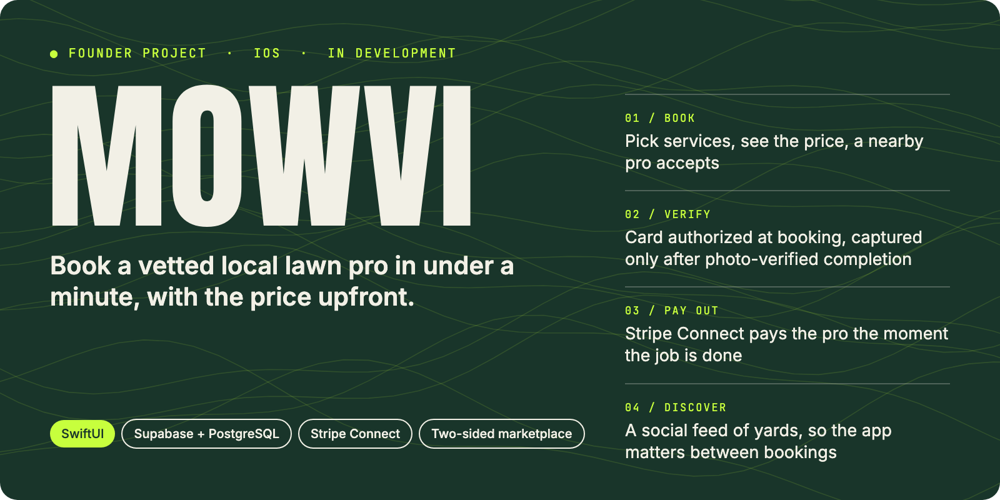

**Mowvi** is a two-sided marketplace. Homeowners book lawn care with an upfront price, local pros accept the job, and the platform handles everything in between. It's a native iOS app on a Supabase/PostgreSQL backend, with Stripe Connect for payments.

- **Escrow-style payments.** The card is authorized at booking and captured only after the job is verified complete with photos.
- **Instant payouts.** Stripe Connect pays the pro as soon as the job is done.
- **Discover feed.** People post their yards, follow each other and see which pro did the work, so the app is useful between bookings.

 

## ◼ Selected work

### 🏁 PADDOCKK · *The sport, decoded.*

<a href="https://paddockk.alishsharma88.workers.dev">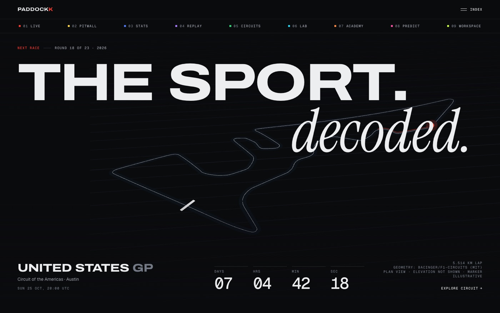</a>

<table>
  <tr>
    <td width="50%">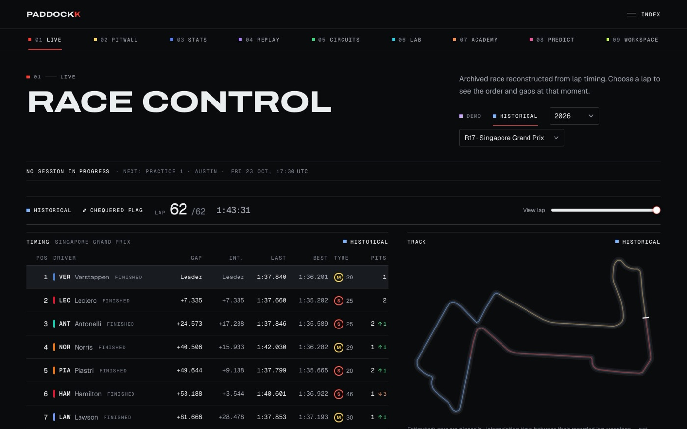 <b>Live</b>: the race reconstructed lap by lap</td>
    <td width="50%">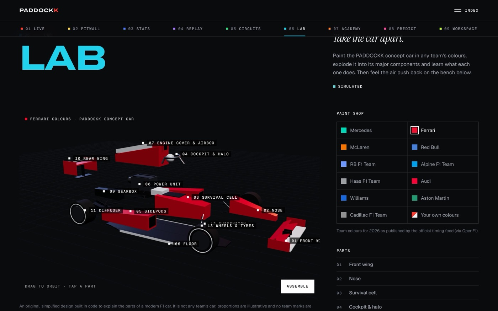 <b>Lab</b>: explode a concept car into 13 parts</td>
  </tr>
</table>

An independent Formula 1 platform with **nine modules**: live timing, a strategy model you can share as a link, stats, replays of any race since 1996, all 23 circuits in 3D, a car you can take apart, interactive lessons, predictions, and a widget workspace you build yourself. Every number shows where its data came from.

`Next.js 16` `React 19` `TypeScript` `Three.js / R3F` `Supabase` `Cloudflare Workers` `Vitest` `Playwright`

**[▶ Live site](https://paddockk.alishsharma88.workers.dev)** · [Source](https://github.com/alishsharma17/apex)

 

### 🌍 EARTH//PULSE · *A living planet you can explore.*

<a href="https://pulse.alishsharma88.workers.dev">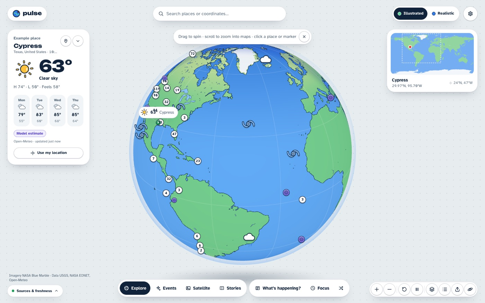</a>

Spin an illustrated 3D Earth, then dive from space to street-level maps without a seam. The globe and map share one camera model, and the handoff between them measures **0 px** of drift, even across the antimeridian. It has live earthquakes, storms, fires and volcanoes, weather, dated satellite imagery, guided stories and a Pomodoro timer, with a source and timestamp on every data point.

`Next.js` `React Three Fiber` `MapLibre GL` `NASA GIBS / EONET` `USGS` `Open-Meteo` `Cloudflare Workers`

**[▶ Live site](https://pulse.alishsharma88.workers.dev)** · [Source](https://github.com/alishsharma17/pulse)

 

### 🤖 KINETIC · *Movement becomes instruction.*

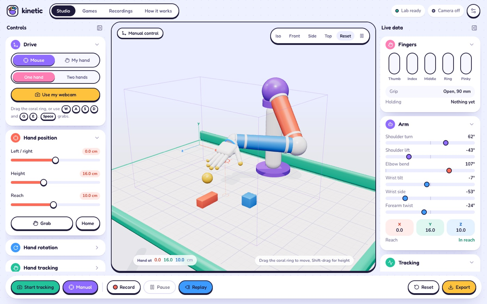

<table>
  <tr>
    <td width="50%">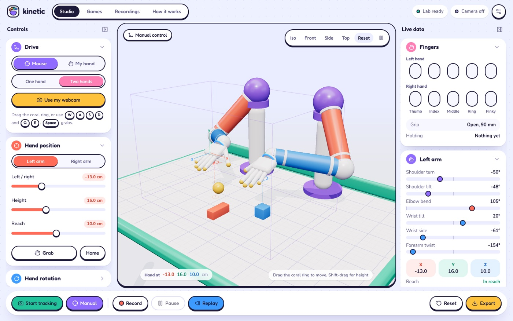 <b>Two hands</b>: whole-hand mirroring from a webcam</td>
    <td width="50%">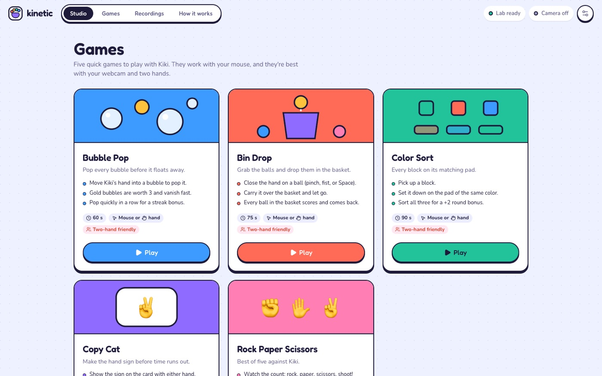 <b>Games</b>: five mini-games you play with your hands</td>
  </tr>
</table>

A robotics lab in the browser. Your webcam watches your hand, and **Kiki**, a humanoid robot arm, copies it: palm, wrist twist, and every finger joint. It uses closed-form inverse kinematics, MediaPipe running in a Web Worker, One Euro smoothing, and Rapier physics so you can pick things up. You can record demonstrations at 30 Hz and export them as JSON for training data. Everything runs locally, with no backend.

`React` `TypeScript` `Three.js` `MediaPipe` `Rapier` `Web Workers` `IndexedDB` `Vite` `Playwright`

[Source](https://github.com/alishsharma17/kinetic)

 

### ✦ Portfolio · *An interactive poster with a codebase under its surface.*

<table>
  <tr>
    <td width="50%">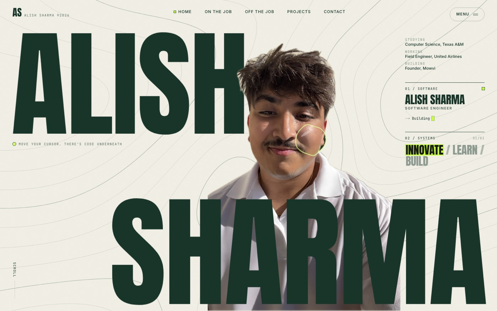 <b>Home</b>: move the cursor and the lens reveals hidden code</td>
    <td width="50%">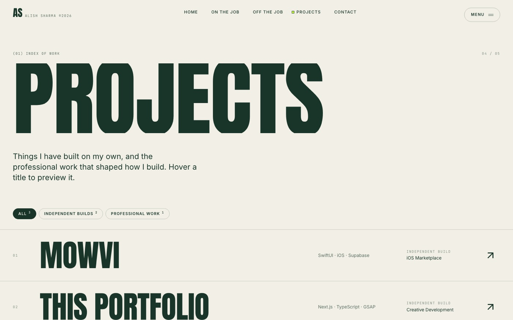 <b>Projects</b>: an editorial index with hover previews</td>
  </tr>
</table>

My personal site, built as an interactive editorial piece. A topographic contour field drawn with **marching squares** reacts to your cursor, and a 48px **liquid-glass lens** follows the pointer to reveal a hidden layer of code. It has a cinematic preloader, panel-wipe page transitions, pinned scroll sections and horizontal galleries, plus fallbacks for reduced motion and touch. All content lives in typed data files, so updating it never means touching animation code.

`Next.js 16` `TypeScript` `GSAP + ScrollTrigger` `Lenis` `Canvas` `Tailwind CSS v4`

[Source](https://github.com/alishsharma17/alish-portfolio)

 

### 🧠 BRAINROT.EXE · *Your last two brain cells are fighting for third place.*

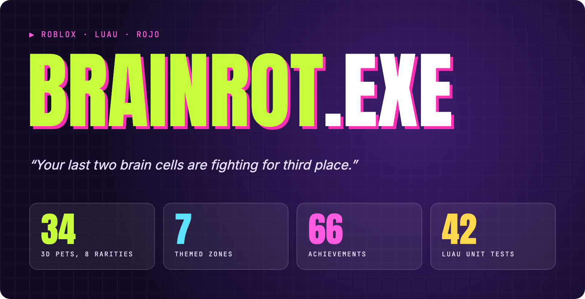

An intentionally absurd, surprisingly deep **Roblox simulator** with 18 generators, 34 code-built 3D pets, 23 random events, seven zones, a boss fight against *The Algorithm*, and a 24-node prestige skill tree. Underneath is serious engineering: a server-authoritative engine, DataStores with session locking, idempotent purchase receipts, and 42 unit tests type-checked against the Roblox API.

`Luau` `Rojo` `DataStoreService` `MarketplaceService` `luau-lsp`

[Source](https://github.com/alishsharma17/brainrot)

 

## ◼ Earlier work

| | Project | What it is |
| :-: | --- | --- |
| 🚗 | **MechAI** | AI vehicle diagnostics: upload a photo and get likely issues and troubleshooting steps. React Native + FastAPI. |
| 🏢 | **Enterprise AD & Network Homelab** | Windows Server lab with Active Directory, DNS, DHCP, VLANs, inter-VLAN routing, VMware and Cisco gear. |
| 🔌 | **Network Automation** | Python tools that automate config management, monitoring and admin tasks across enterprise networks. |

 

## ◼ Toolbox

   
   
  

**Also:** React Native & Expo · SwiftUI · MapLibre · MediaPipe · Vitest & Playwright · Cisco routing & switching · Windows Server / Active Directory · VMware

 

Built, tested and shipped by Alish Sharma · <a href="https://www.linkedin.com/in/alish-sharma-357760257/">LinkedIn</a> · <a href="mailto:alish1704@tamu.edu">alish1704@tamu.edu</a>

