

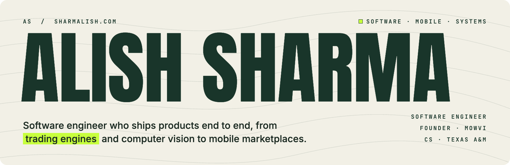

  

       

 

I'm a **software engineer** who designs, builds and ships complete products: a C++ exchange compiled to WebAssembly, a real time computer vision platform, a market data lab, and **Mowvi**, the lawn care marketplace I'm founding. I study computer science at **Texas A&M**. Everything below lives on my portfolio at **[sharmalish.com](https://sharmalish.com)**.

I like products that work all the way down: the interface, the data model and the engine underneath. Below are things I've designed, built, tested and shipped myself.

 

## ◼ Building now

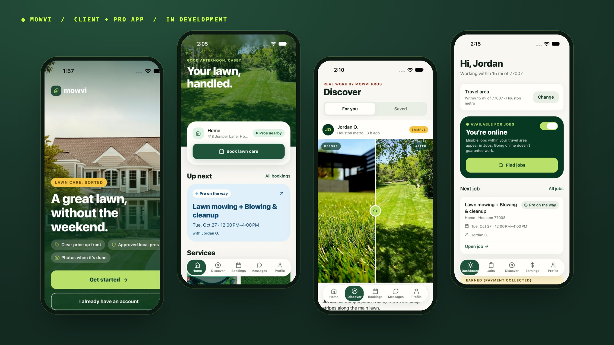

**Mowvi** is a two sided lawn care marketplace. Clients book a scoped job with a server calculated price, approved local pros claim it, do the work and submit photo evidence, and the platform handles everything in between. One Expo app serves both sides, with a client mode and a pro mode.

- **Payments held until the work is done.** The payment is held at booking, captured on completion and reconciled in a ledger, with Stripe underneath.
- **Rules enforced in the database.** Supabase and PostgreSQL with row level security, server side pricing and job state machines, plus integration tests against the local stack.
- **Discover feed.** Before and after photos from real jobs, so the app is useful between bookings.
- **Operations console.** A Next.js admin, protected by MFA, for handling exceptions.

`Expo` `React Native` `TypeScript` `Supabase` `PostgreSQL` `Stripe` `Next.js`

*Development prototype: runs against synthetic data and a payment simulator.*

 

## ◼ Selected work

### 📈 EXCHANGE · *A market, built from first principles.*

<a href="https://exchange-one-tau.vercel.app">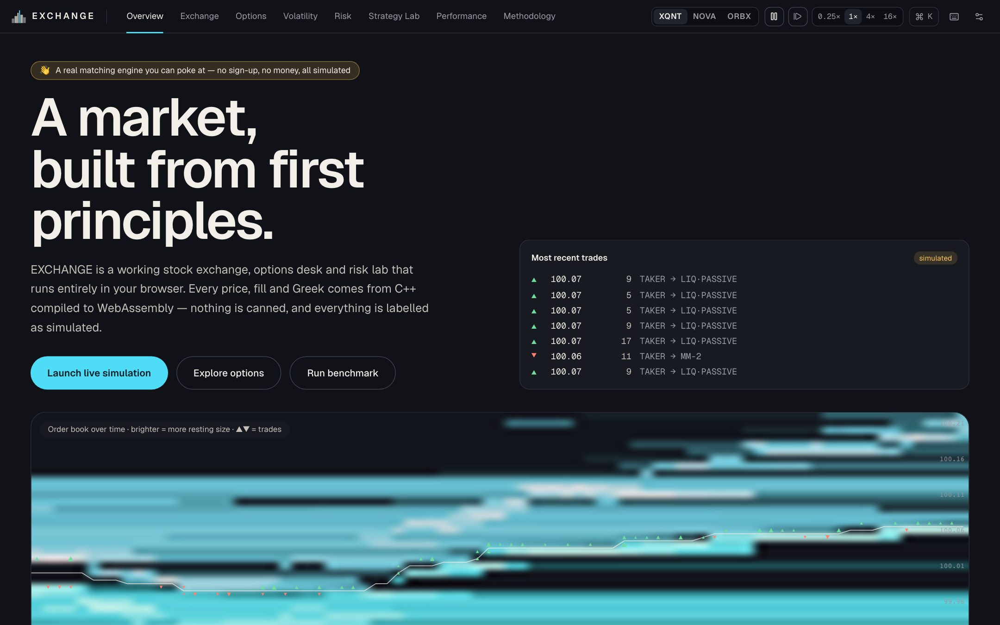</a>

<table>
  <tr>
    <td width="50%">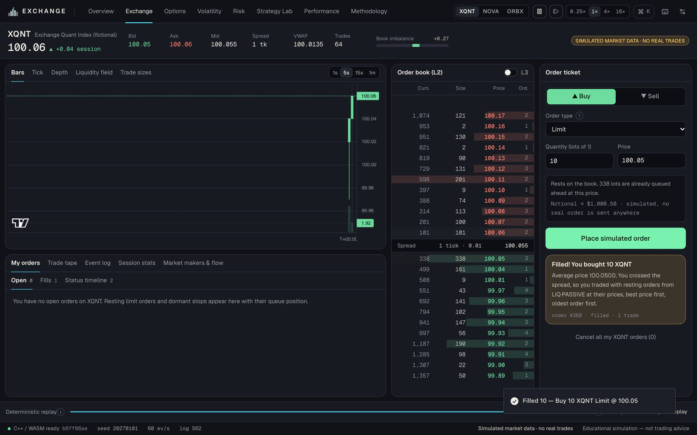 <b>Exchange</b>: trade against a real C++ order book</td>
    <td width="50%">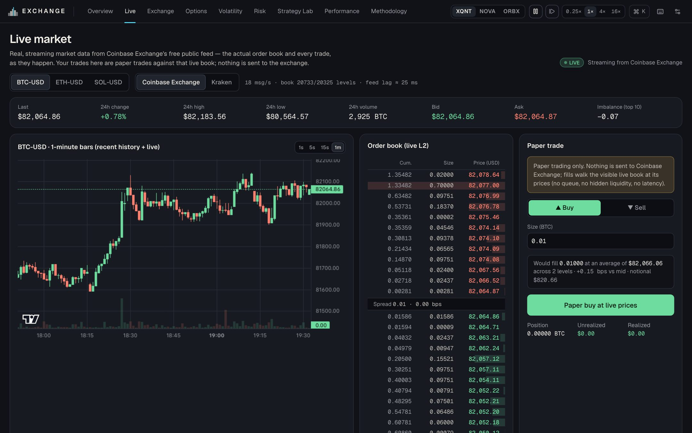 <b>Live</b>: a real Bitcoin order book, streaming</td>
  </tr>
</table>

A working stock exchange, options desk and risk lab that runs entirely in your browser. The core is a **C++20 price-time-priority matching engine** and quant library compiled to **WebAssembly**, running in Web Workers behind a React interface. You trade against seeded market makers, price options, shape a volatility surface, stress a portfolio and backtest strategies on the same engine — and a **Live** page streams the real Bitcoin, Ether and Solana order books from Coinbase and Kraken. Simulated data is labelled simulated; live data is labelled live.

- **Matching engine.** Integer-tick limit order book with limit, market, IOC, FOK, post-only and stop orders, cancel/replace priority rules and self-trade prevention. Sessions are event-sourced: replaying the log reproduces a 64-bit state hash, and the native and WebAssembly builds reach identical hashes.
- **Quant library.** Black–Scholes–Merton with Greeks, an implied-vol solver, a CRR binomial tree, seeded Monte Carlo with antithetic and control variates, volatility surfaces with arbitrage checks, and portfolio scenarios with VaR and expected shortfall.
- **Live market data.** Real order books and trades over public WebSockets, parsed off the main thread, with stale/reconnect handling, recent history, and paper trading that walks the live book to show slippage.
- **Tested end to end.** 77 GoogleTest cases (including randomized property tests, also run under AddressSanitizer and UBSan), 55 Vitest tests against the shipped `.wasm` and recorded real feed messages, and 34 Playwright tests including automated accessibility checks.

`C++20` `WebAssembly / Emscripten` `Next.js 16` `React 19` `TypeScript` `Web Workers` `WebSockets` `Plotly` `GoogleTest` `Vitest` `Playwright` `Vercel`

**[▶ Live site](https://exchange-one-tau.vercel.app)** · [Source](https://github.com/alishsharma17/EXCHANGE)

 

### 👁️ SPECTRA · *See. Understand. Act.*

<a href="https://spectra-fawn-ten.vercel.app/vision">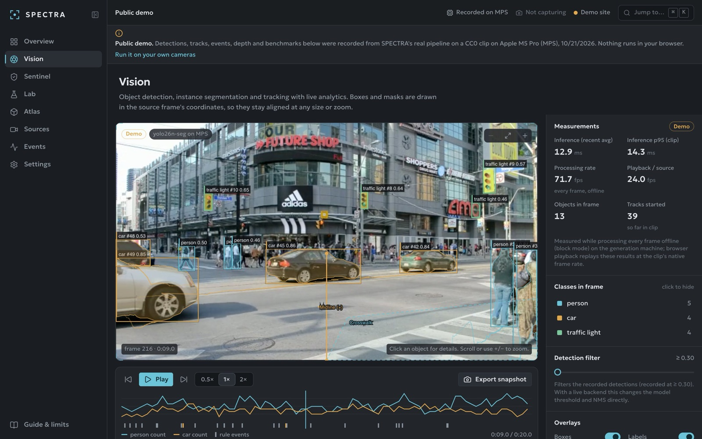</a>

<table>
  <tr>
    <td width="50%">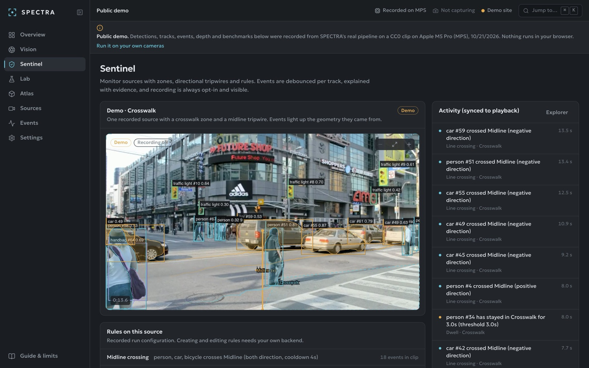 <b>Sentinel</b>: debounced zone and tripwire events</td>
    <td width="50%">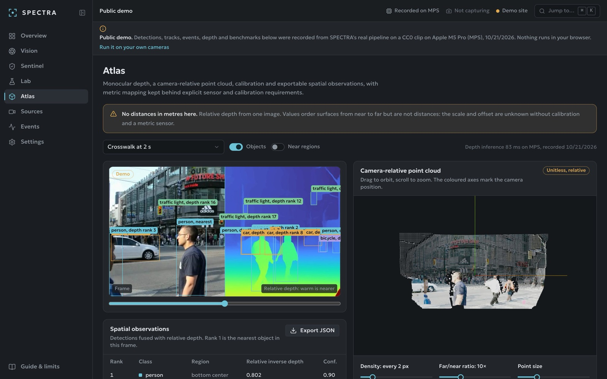 <b>Atlas</b>: relative depth and a 3D point cloud</td>
  </tr>
</table>

A real-time computer vision platform that runs on your own hardware. A Python engine decodes video, runs YOLO26 detection and segmentation on the GPU, tracks objects across frames, and turns them into debounced events for zones and tripwires. A FastAPI service streams typed results over WebSockets to a Next.js workspace that draws overlays aligned to the video. On the public site you can **point your own camera at it**: the detector and tracker run in your browser on WebGPU (12.7 ms p50 from frame to result), and frames never leave your device. A labelled recording of the full server pipeline is there too.

- **Bounded-latency streaming.** Decode and inference threads joined by a bounded queue: live mode drops stale frames, so latency can't build up, while replay mode processes every frame in order. From frame decode to client it measures **24.4 ms p50 / 29.2 ms p99** with YOLO on an Apple M5 Pro.
- **Tracking from first principles.** My own ByteTrack-style tracker: a Kalman filter plus two-stage optimal assignment, at **0.24 ms per frame** for 10 objects. The rule engine adds hysteresis and cooldowns, so one crossing fires one event.
- **Measured, not assumed.** Back-to-back benchmarks said **7.1 ms** per inference; at a 15 Hz duty cycle it's **~24 ms**, because the GPU idles between calls. I also reproduced and fixed a GPU race that crashed the server when models were switched. All numbers come from scripts in the repo.
- **Secure by test.** Workspace RBAC, CSRF protection, SSRF defence for camera URLs, encrypted credentials, and opt-in, visible recording — covered by 92 pytest tests, including runs with real model weights.

`Python` `PyTorch (MPS)` `OpenCV` `FastAPI` `WebSockets` `SQLAlchemy` `NumPy / SciPy` `Next.js 16` `React 19` `TypeScript` `Three.js / R3F` `Vercel`

**[▶ Live site](https://spectra-fawn-ten.vercel.app)** · [Source](https://github.com/alishsharma17/spectra)

 

### 📡 TICKWIRE · *Market data, engineered.*

<a href="https://tickwire-sigma.vercel.app">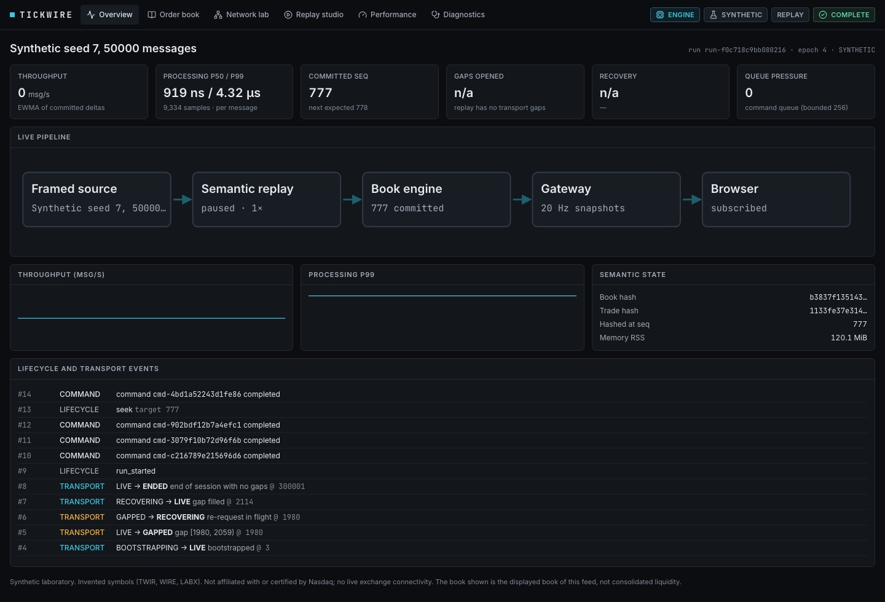</a>

<table>
  <tr>
    <td width="50%">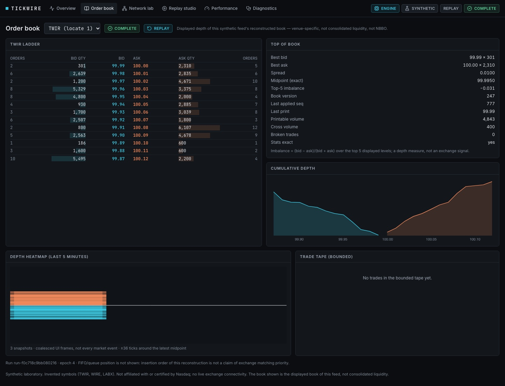 <b>Order book</b>: the reconstructed ladder and depth</td>
    <td width="50%">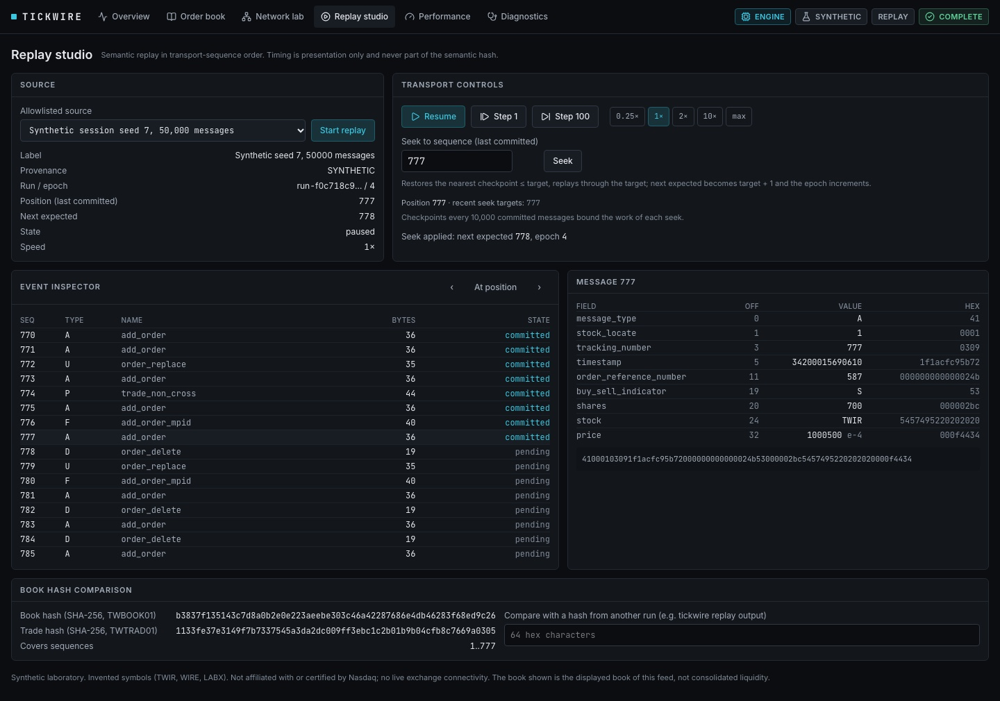 <b>Replay studio</b>: step through every message</td>
  </tr>
</table>

A market data engineering lab in **C++20**. It decodes **Nasdaq TotalView ITCH 5.0 over MoldUDP64 on real UDP sockets**, pushes the feed through a deterministic fault proxy, recovers lost packets with UDP retransmission and rebuilds the order book transactionally. The same engine, compiled to **WebAssembly**, powers the public demo in your browser and reproduces the native book and trade hashes.

- **Recovery you can verify.** Gaps, including tail loss only revealed by heartbeats, are re requested over UDP, and the run ends with book and trade hashes identical to the clean run.
- **Fails honestly.** Unrecoverable holes end in `FAILED` with the last valid prefix, never reported healthy.
- **Reproducible.** Virtual time simulation with exact trace hashes, byte exact replay, and checkpoint seek equal to linear replay.
- **Fast.** About 119 M messages per second ITCH decode on one core, and a 30 minute soak with continuous loss that recovers 44k gaps.

`C++20` `UDP / MoldUDP64` `Boost.Beast` `WebAssembly` `Next.js` `TypeScript` `Vercel`

**[▶ Live site](https://tickwire-sigma.vercel.app)** · [Source](https://github.com/alishsharma17/tickwire)

 

### 🏁 PADDOCKK · *The sport, decoded.*

<a href="https://paddockk.alishsharma88.workers.dev">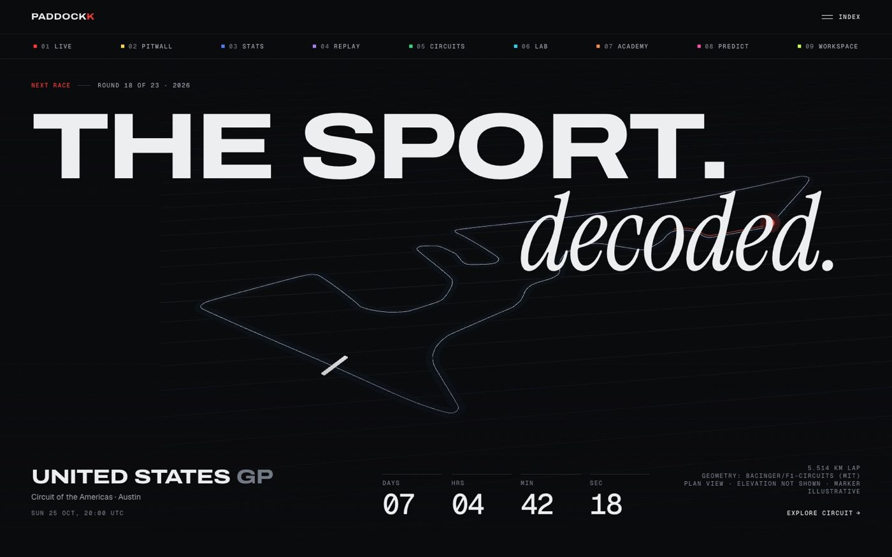</a>

<table>
  <tr>
    <td width="50%">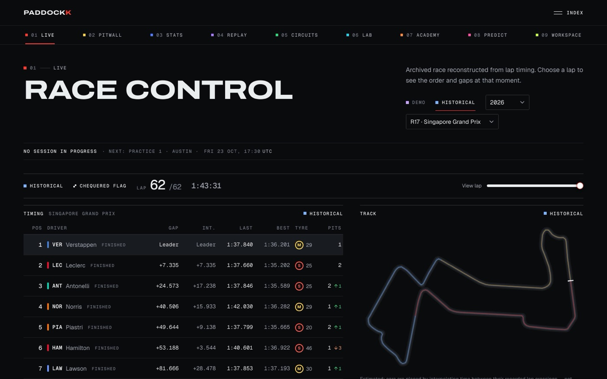 <b>Live</b>: the race reconstructed lap by lap</td>
    <td width="50%">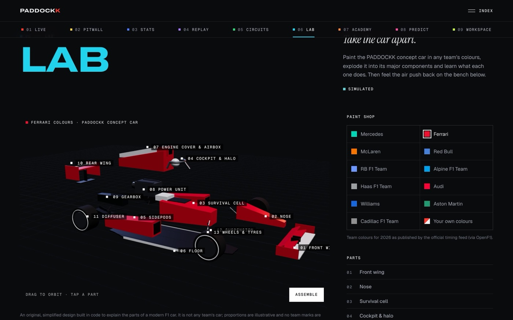 <b>Lab</b>: explode a concept car into 13 parts</td>
  </tr>
</table>

An independent Formula 1 platform with **nine modules**: live timing, a strategy model you can share as a link, stats, replays of any race since 1996, all 23 circuits in 3D, a car you can take apart, interactive lessons, predictions, and a widget workspace you build yourself. Every number shows where its data came from.

`Next.js 16` `React 19` `TypeScript` `Three.js / R3F` `Supabase` `Cloudflare Workers` `Vitest` `Playwright`

**[▶ Live site](https://paddockk.alishsharma88.workers.dev)** · [Source](https://github.com/alishsharma17/apex)

 

### 🌍 EARTH//PULSE · *A living planet you can explore.*

<a href="https://pulse.alishsharma88.workers.dev">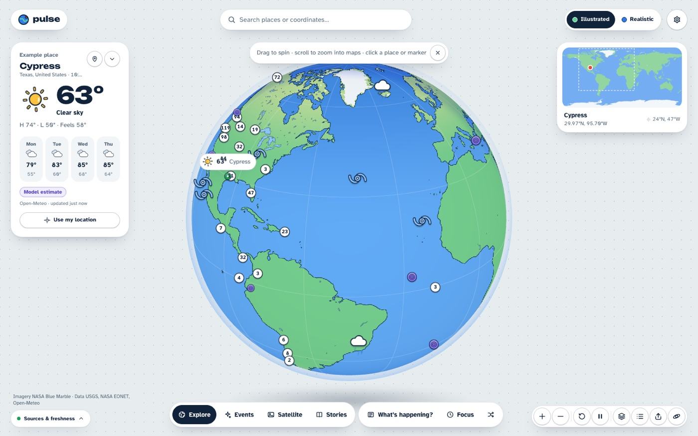</a>

Spin an illustrated 3D Earth, then dive from space to street-level maps without a seam. The globe and map share one camera model, and the handoff between them measures **0 px** of drift, even across the antimeridian. It has live earthquakes, storms, fires and volcanoes, weather, dated satellite imagery, guided stories and a Pomodoro timer, with a source and timestamp on every data point.

`Next.js` `React Three Fiber` `MapLibre GL` `NASA GIBS / EONET` `USGS` `Open-Meteo` `Cloudflare Workers`

**[▶ Live site](https://pulse.alishsharma88.workers.dev)** · [Source](https://github.com/alishsharma17/pulse)

 

### 🤖 KINETIC · *Movement becomes instruction.*

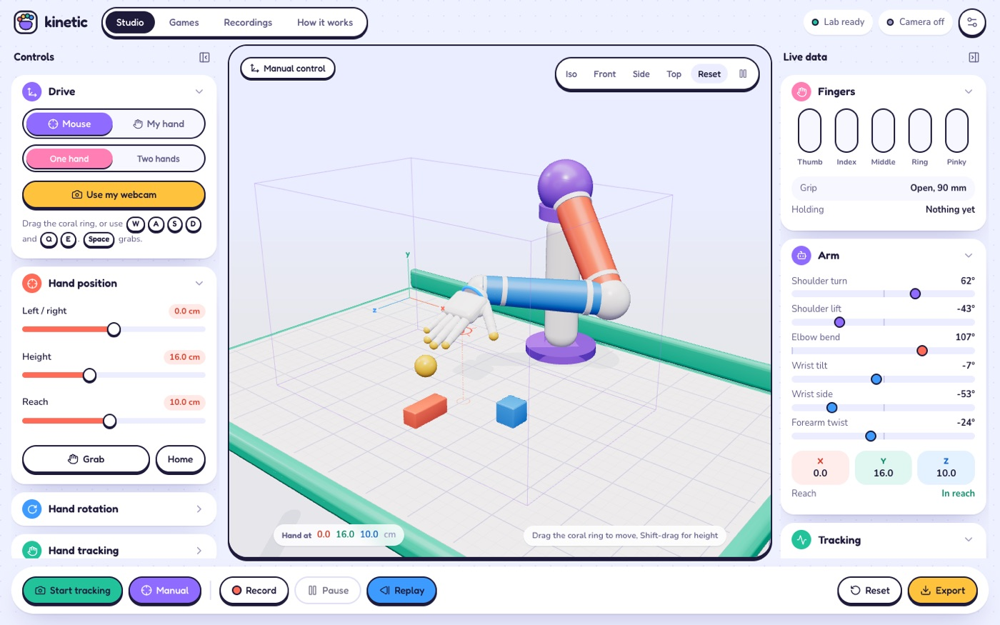

<table>
  <tr>
    <td width="50%">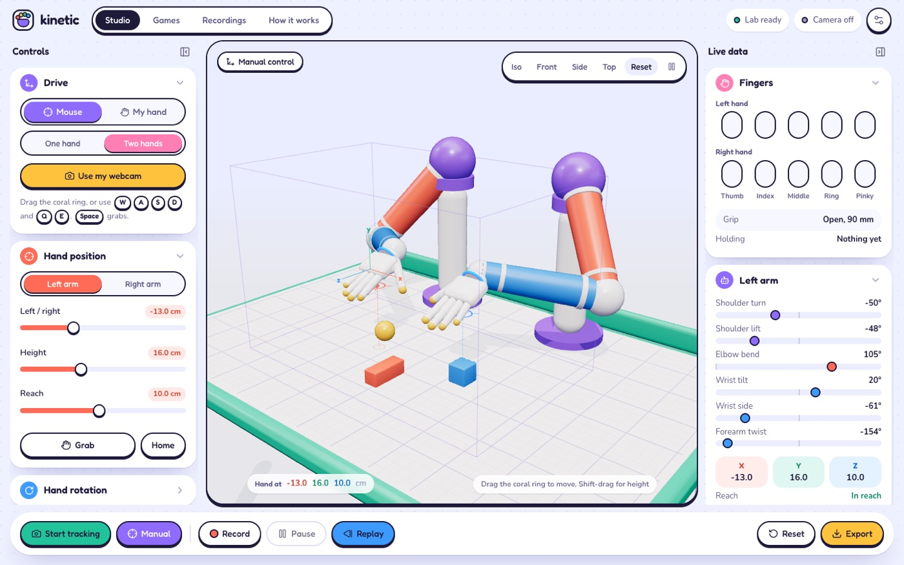 <b>Two hands</b>: whole-hand mirroring from a webcam</td>
    <td width="50%">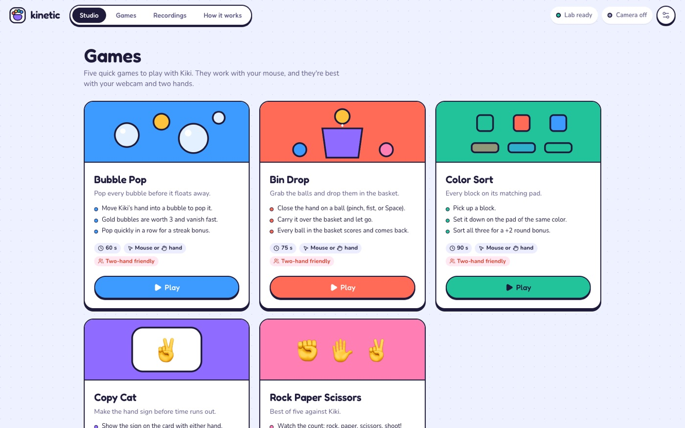 <b>Games</b>: five mini-games you play with your hands</td>
  </tr>
</table>

A robotics lab in the browser. Your webcam watches your hand, and **Kiki**, a humanoid robot arm, copies it: palm, wrist twist, and every finger joint. It uses closed-form inverse kinematics, MediaPipe running in a Web Worker, One Euro smoothing, and Rapier physics so you can pick things up. You can record demonstrations at 30 Hz and export them as JSON for training data. Everything runs locally, with no backend.

`React` `TypeScript` `Three.js` `MediaPipe` `Rapier` `Web Workers` `IndexedDB` `Vite` `Playwright`

[Source](https://github.com/alishsharma17/kinetic)

 

### ✦ sharmalish.com · *An interactive poster with a codebase under its surface.*

<table>
  <tr>
    <td width="68%">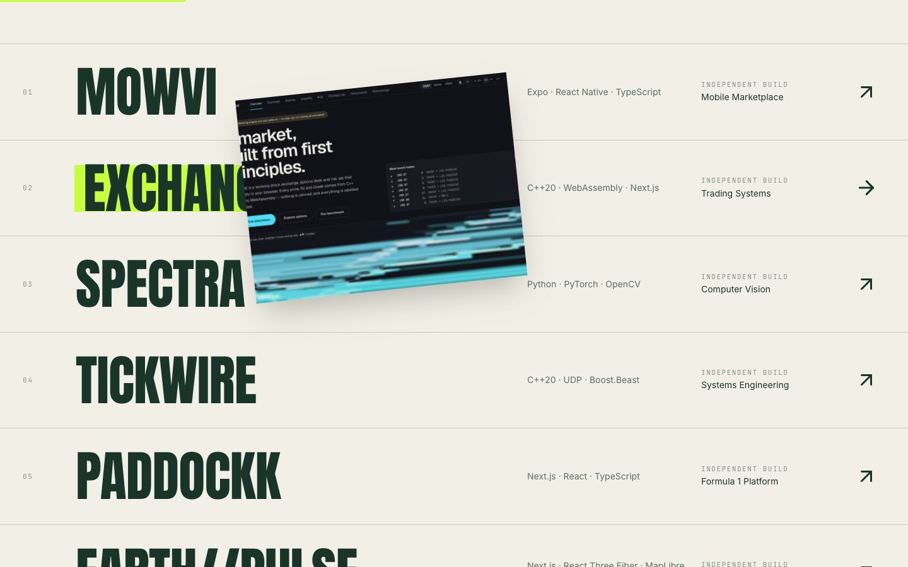 <b>Projects</b>: an editorial index with cursor following previews</td>
    <td width="32%"> <b>Mobile</b>: designed for phones, not shrunk</td>
  </tr>
</table>

My personal site, built as an interactive editorial piece. A topographic contour field drawn with **marching squares** reacts to your cursor, and a 48px **liquid glass lens** follows the pointer to reveal a hidden layer of code. It has a cinematic preloader, panel wipe page transitions, pinned scroll sections and horizontal galleries, plus fallbacks for reduced motion and touch. Every project on this page has its own page there with screenshots, and every push to `main` deploys automatically on Vercel.

`Next.js 16` `TypeScript` `GSAP + ScrollTrigger` `Lenis` `Canvas` `Tailwind CSS v4` `Vercel`

**[▶ sharmalish.com](https://sharmalish.com)** · [Source](https://github.com/alishsharma17/alish-portfolio)

 

## ◼ Earlier work

| | Project | What it is |
| :-: | --- | --- |
| 🚗 | **MechAI** | AI vehicle diagnostics: upload a photo and get likely issues and troubleshooting steps. React Native + FastAPI. |
| 🏢 | **Enterprise AD & Network Homelab** | Windows Server lab with Active Directory, DNS, DHCP, VLANs, inter-VLAN routing, VMware and Cisco gear. |
| 🔌 | **Network Automation** | Python tools that automate config management, monitoring and admin tasks across enterprise networks. |

 

## ◼ Toolbox

   
   
  

**Also:** C++20 & WebAssembly (Emscripten) · PyTorch & OpenCV · GoogleTest · React Native & Expo · Swift · MapLibre · MediaPipe · Vitest & Playwright · WebSockets & Web Workers

 

Built, tested and shipped by Alish Sharma · <a href="https://sharmalish.com">sharmalish.com</a> · <a href="https://www.linkedin.com/in/alish-sharma-357760257/">LinkedIn</a> · <a href="mailto:alishsharma04@gmail.com">alishsharma04@gmail.com</a>

